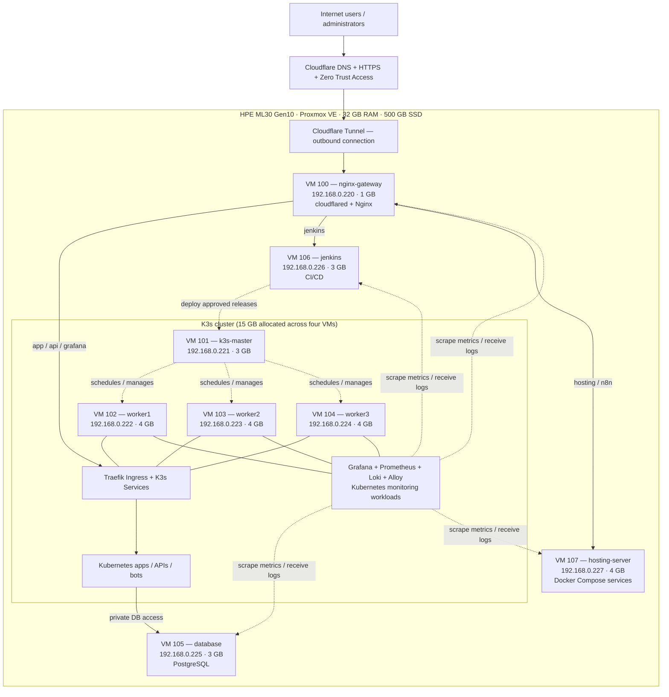

# HPE ProLiant ML30 Gen10 — Final Proxmox DevOps Homelab Plan

**Status:** Proposed architecture / implementation reference  
**Date:** 2026-11-08  
**Goal:** Run an eight-VM DevOps homelab with K3s, dedicated hosting, Jenkins CI/CD, PostgreSQL, Cloudflare Tunnel, and centralized monitoring **within 32 GB RAM**.

> [!IMPORTANT]
> This is designed for learning, development, and **light production-like workloads**, not for high availability or heavy simultaneous builds. Everything runs on **one physical server**. Confirm current VM IDs, IP availability, and Proxmox storage capacity before provisioning.

## 1. Physical hardware

| Component | Specification |
|---|---|
| Server | HPE ProLiant ML30 Gen10 4LFF Hot-Plug CTO |
| CPU | Intel Xeon E-2224, **4 physical cores / 4 threads** (assumed from existing configuration) |
| Memory | **32 GB RAM** |
| Drive | **500 GB SSD** |
| Hypervisor | Proxmox VE |
| Virtual machines | **8** |
| Cluster | K3s: **1 control-plane server + 3 agents (workers)** |
| External access | **Cloudflare Tunnel → Nginx gateway** |
| Monitoring | **Grafana + Prometheus + Loki + Alloy**, hosted as **K3s workloads** |

### Capacity targets

| Resource | Allocated to VMs | Nominal remainder | Notes |
|---|---:|---:|---|
| RAM | **26 GB** | **6 GB** | Remaining memory is for Proxmox, host caching, and overhead; not a guarantee of 6 GB always free. |
| vCPU | **14 vCPUs** | **4 physical cores total** | 3.5:1 vCPU-to-physical-core allocation. vCPUs share host CPU time. |
| Virtual disk | **350 GB** | **150 GB vs 500 GB nominal SSD size** | Proxmox OS, storage pools, thin provisioning, metadata, snapshots, and backups reduce actual available space. Verify `pvesm status`. |

**CPU guidance:** A busy CPU does not normally crash Proxmox by itself. CPU contention causes slower applications, delayed jobs, and possible timeouts/liveness-probe failures. Heavy memory pressure, full disks, thermal faults, or physical hardware problems are greater stability risks.

---

## 2. Network plan

| Setting | Planned value |
|---|---|
| Proxmox management | `192.168.0.200` (verify actual address) |
| Router / default gateway | `192.168.0.1` |
| LAN subnet | `192.168.0.0/24` |
| Linux bridge | `vmbr0` |
| VM IPs | `192.168.0.220` – `192.168.0.227` |
| Primary domain | `sopanha.digital` |
| Guest OS | Ubuntu Server 24.04 LTS (suggested baseline) |
| VM SSH authentication | SSH public keys, not reused passwords |

**Before deployment:** Ensure `.220`–`.227` are unused and reserved/excluded from the DHCP pool. The VM IDs 100–107 might conflict with an earlier Proxmox homelab; **never overwrite or destroy existing VMs**. Replace IDs with available ones if necessary.

## 3. Final VM allocation

| VM ID | Hostname | Role | vCPU | RAM | Disk | Static IP |
|---:|---|---|---:|---:|---:|---|
| 100 | `nginx-gateway` | Nginx reverse proxy + `cloudflared` | 1 | **1 GB** | 15 GB | `192.168.0.220` |
| 101 | `k3s-master` | K3s control plane | 2 | **3 GB** | 25 GB | `192.168.0.221` |
| 102 | `k3s-worker1` | K3s agent + apps + monitoring | 2 | **4 GB** | 50 GB | `192.168.0.222` |
| 103 | `k3s-worker2` | K3s agent + apps + monitoring | 2 | **4 GB** | 50 GB | `192.168.0.223` |
| 104 | `k3s-worker3` | K3s agent + apps + monitoring | 2 | **4 GB** | 50 GB | `192.168.0.224` |
| 105 | `database` | PostgreSQL, private LAN only | 2 | **3 GB** | 60 GB | `192.168.0.225` |
| 106 | `jenkins` | Jenkins CI/CD | 2 | **3 GB** | 60 GB | `192.168.0.226` |
| 107 | `hosting-server` | Ubuntu + Docker/Compose for independent apps | 1 | **4 GB** | 40 GB | `192.168.0.227` |
| **TOTAL** | **8 VMs** | | **14** | **26 GB** | **350 GB** | |

**Why there is no ninth monitoring VM:** Grafana, Prometheus, and Loki run in K3s and use resources **inside the three 4 GB worker allocations**. VM 107 stays available as a **dedicated hosting server**.

## 4. End-to-end infrastructure diagram



**Actual web request flow:** `Client → Cloudflare → cloudflared on VM 100 → Nginx → (Traefik on workers OR Jenkins OR Hosting VM)`.

**Note:** The master controls cluster state but **does not sit in the HTTP request path** to apps. K3s worker HTTP ingress goes through Traefik and Kubernetes Services. The diagram is a conceptual overview; monitoring pods can be rescheduled across workers rather than fixed to particular nodes.

## 5. Cloudflare and Nginx design

- Use a **dedicated Cloudflare Tunnel** for the gateway, to avoid unintentionally breaking an existing tunnel.
- Run the `cloudflared` connector **on VM 100**.
- Run Nginx on VM 100, listening on **`127.0.0.1:80`** for tunnel traffic if the connector and Nginx are on the same VM.
- Publish each desired hostname through Cloudflare Tunnel to `http://127.0.0.1:80`.
- Configure Nginx virtual hosts to route by **Host** header.
- Do **not** forward internet ports from the router to Proxmox or the VMs.

| DNS hostname | Nginx target | Security policy |
|---|---|---|
| `app.sopanha.digital` | Traefik on K3s workers, port 80 | Public or application-specific auth |
| `api.sopanha.digital` | Traefik on K3s workers, port 80 | API authentication and rate limiting |
| `grafana.sopanha.digital` | Traefik → Grafana Kubernetes Service | **Cloudflare Access** + Grafana login |
| `jenkins.sopanha.digital` | `192.168.0.226:8080` | **Cloudflare Access** + Jenkins login |
| `hosting.sopanha.digital` | `192.168.0.227:80` (when deployed) | Based on app sensitivity |
| `n8n.sopanha.digital` | Hosting VM reverse proxy → n8n (optional) | **Cloudflare Access** if private |

**Never publish** `192.168.0.225:5432` (PostgreSQL), the K3s API `:6443`, or unprotected Prometheus/Loki endpoints as public web routes. Keep Proxmox management private and use a separately secured private-access strategy if remote administration is necessary.

### Nginx routing example (outline)

```nginx
upstream k3s_ingress {
    server 192.168.0.222:80;
    server 192.168.0.223:80;
    server 192.168.0.224:80;
}

# Put inside Nginx's http context (usually /etc/nginx/conf.d/...)
map $http_upgrade $connection_upgrade {
    default upgrade;
    ''      close;
}

server {
    listen 127.0.0.1:80;
    server_name app.sopanha.digital api.sopanha.digital grafana.sopanha.digital;
    location / {
        proxy_pass http://k3s_ingress;
        proxy_http_version 1.1;
        proxy_set_header Host $host;
        proxy_set_header X-Forwarded-Proto https;
        proxy_set_header X-Forwarded-For $proxy_add_x_forwarded_for;
        proxy_set_header Upgrade $http_upgrade;
        proxy_set_header Connection $connection_upgrade;
    }
}

server {
    listen 127.0.0.1:80;
    server_name jenkins.sopanha.digital;
    location / {
        proxy_pass http://192.168.0.226:8080;
        proxy_http_version 1.1;
        proxy_set_header Host $host;
        proxy_set_header X-Forwarded-Proto https;
        proxy_set_header X-Forwarded-For $proxy_add_x_forwarded_for;
        proxy_set_header Upgrade $http_upgrade;
        proxy_set_header Connection $connection_upgrade;
    }
}

server {
    listen 127.0.0.1:80;
    server_name hosting.sopanha.digital;
    location / {
        proxy_pass http://192.168.0.227:80;
        proxy_set_header Host $host;
        proxy_set_header X-Forwarded-Proto https;
    }
}

server {
    listen 127.0.0.1:80 default_server;
    return 404;
}
```

The example assumes K3s Traefik/ServiceLB exposes port 80 on the chosen worker IPs. Verify that these endpoints are reachable from VM 100 before using the upstream configuration. Also configure proper application-side proxy trust and authentication: **a Host header alone is not access control**.

## 6. K3s cluster design

- **Control plane (VM 101):** K3s server managing the cluster. Initial setup can use the default embedded SQLite datastore.
- **Workers (VMs 102–104):** Run websites, APIs, internal services, and the Grafana monitoring stack.
- **Traefik Ingress:** Receives traffic from Nginx, then routes requests to Kubernetes Services and pods.
- **Container runtime:** Bundled `containerd` provided by K3s.
- **Persistent volumes:** Use a deliberate PV/StorageClass plan for Prometheus, Loki, and Grafana; default local-path PVs are **node-local**, not automatically replicated.
- **Application configuration:** Use namespaces, requests/limits, health probes, and Secrets. Do not hard-code credentials in manifests or repositories.

### Kubernetes resource discipline

Each worker has **4 GB total**. This includes Ubuntu, kubelet/K3s, system pods, monitoring, and apps. Resource requests/limits must leave room for system components.

Start with conservative monitoring settings, for example:

| Component | Initial memory request | Initial memory limit | Notes |
|---|---:|---:|---|
| Prometheus | 512 MiB | 1,024 MiB | Small scrape target count and 15-day retention; monitor usage. |
| Loki (single binary) | 256 MiB | 768 MiB | Low log volume and 7-day retention. |
| Grafana | 128 MiB | 512 MiB | Few dashboards/users. |
| Alloy | 64 MiB per agent | 256 MiB per agent | Agent count varies by DaemonSet and integrations. |

These are **starting estimates, not guaranteed requirements**. kube-state-metrics, exporters, Traefik, OS usage, and Kubernetes overhead consume additional memory. Adjust actual limits based on measured usage and prevent monitoring from evicting application pods.

## 7. Grafana monitoring and centralized logs

Monitoring runs **in K3s**; there is **no separate monitoring VM**.

| Component | Where | Purpose |
|---|---|---|
| Grafana | K3s Deployment | Dashboards, metrics exploration, logs, alerting |
| Prometheus | K3s StatefulSet / Helm deployment | Metrics scraping and time-series storage |
| Loki | K3s deployment with persistent storage | Central log query/storage |
| Grafana Alloy | K3s DaemonSet + agents on selected VMs | Container/system log shipping and other telemetry |
| Node Exporter | Linux VMs and/or K3s hosts | CPU, memory, disk, network |
| kube-state-metrics | K3s | Deployments, pods, resource state |
| PVE exporter | Monitoring integration | Proxmox host/VM metrics via read-only API credentials |
| PostgreSQL exporter | DB VM or service | Database health and connections |
| Jenkins metrics plugin/exporter | Jenkins VM | Job/queue/executor information |

### What Grafana should show

1. **Proxmox overview:** Physical CPU utilization, memory pressure, SSD usage, VM uptime.
2. **VM dashboard:** CPU/memory/disk/network for all eight VMs.
3. **K3s dashboard:** Node Ready state, pod CPU/memory, restarts, deployments, pending pods.
4. **Web application dashboard:** Request rates, HTTP 4xx/5xx, latency **when instrumented**.
5. **Jenkins dashboard:** Job duration, queue, successes/failures, executor use.
6. **PostgreSQL dashboard:** Connections, locks, cache hit rate, disk growth.
7. **Log explorer:** K3s pod stdout/stderr; Nginx access/error logs; Jenkins, PostgreSQL, and system logs.

### Initial data retention

| Data | Starting policy |
|---|---|
| Prometheus metrics | **15 days** |
| Loki logs | **7 days** |
| Prometheus scrape interval | **30 seconds** |
| Debug logs | Collect only when needed |
| Disk alerts | Warn before monitoring storage fills |

Enforce Loki retention with the appropriate compactor configuration, not just a dashboard setting. Size the PVs based on actual ingestion volume and available SSD space.

### Suggested alerts

- Proxmox CPU above ~85–90% for at least 5–10 minutes.
- Available host memory low / swap activity rising.
- SSD/persistent-volume usage above 80–85%.
- K3s node NotReady or repeated container restarts.
- Jenkins build queue growing / repeated failures.
- PostgreSQL down, unhealthy connections, or disk growth.
- Nginx high 5xx error rate; application probes failing.
- Monitoring targets down or Alloy failing to forward logs.

Because the monitoring stack runs on the same physical server, **an entire host outage can prevent Grafana from sending an alert**. Use one external uptime check for critical public endpoints if outage notifications matter.

## 8. Dedicated hosting server (VM 107)

The dedicated hosting VM **remains available** and is not replaced by monitoring.

**VM 107: `hosting-server`**

- IP: `192.168.0.227`
- vCPU: 1
- RAM: 4 GB
- Disk: 40 GB SSD-backed virtual disk
- Software: Ubuntu Server, Docker Engine, Docker Compose, optional local reverse proxy
- Possible workloads: n8n, bots, development websites, small self-hosted applications, utility APIs
- Public access: Cloudflare Tunnel → Nginx Gateway → hosting VM (only when explicitly allowed)

Avoid running many CPU-intensive containers simultaneously on this one-vCPU VM. Use K3s for workloads that benefit from Kubernetes orchestration.

## 9. Jenkins and deployment pipeline

Jenkins VM 106 has **2 vCPUs, 3 GB RAM**. Initially limit concurrent resource-heavy jobs.

**Suggested workflow:**

```text
Git push / webhook
    → Jenkins job
    → Build + unit tests
    → Build container image
    → Push to trusted container registry
    → Deploy into K3s with narrowly scoped credentials
    → Readiness check / rollback on failure
    → Grafana metrics + Loki logs
```

Recommended safeguards:

- Limit heavy Jenkins builds to **one concurrent job** initially.
- Consider `qm set 106 --cpulimit 1` to cap Jenkins to approximately one physical CPU core's worth of runtime during contention; test throughput after applying.
- Do not use the K3s master administrator kubeconfig inside Jenkins; prefer a dedicated, least-privilege deployment identity.
- Store registry credentials, tokens and keys in protected credential stores.
- Keep Jenkins behind Cloudflare Access **and** Jenkins authentication.

## 10. Database design

**VM 105: `database`** runs PostgreSQL and should accept connections only from approved application sources.

- IP: `192.168.0.225`
- TCP port: `5432`, **private**
- Allow authorized K3s nodes/application traffic; verify whether pod traffic uses worker IP masquerading or pod CIDRs.
- Use restricted application accounts, strong passwords, and TLS for sensitive use.
- Schedule database dumps to **off-server storage** and test restoring them.
- Track connections, storage growth, and errors with PostgreSQL exporter and Alloy.

## 11. Security and network isolation

1. **Cloudflare Tunnel** uses outbound connectivity; do not configure router port forwarding for your websites.
2. **Cloudflare Zero Trust Access** is required for Jenkins, Grafana, and other administrative apps.
3. **Nginx loopback listener** minimizes LAN exposure of the tunnel entry point.
4. **Proxmox UI, K3s API, PostgreSQL, Prometheus and Loki** stay private.
5. **SSH** restricted to trusted management hosts or a properly configured secure access method.
6. **Proxmox Firewall / VLANs** can further isolate database and management services.
7. Protect the cluster's K3s join token, Cloudflare Tunnel credentials, database secrets and Jenkins credentials.
8. Keep Ubuntu, K3s, Jenkins, Grafana, Nginx and cloudflared updated.
9. Restrict Kubernetes API port `6443`, Flannel networking (typically UDP `8472` when VXLAN is used), and monitoring exporter ports to trusted sources.
10. Use origin-side Access validation where supported, in addition to Cloudflare Access policies.

## 12. Stability, performance and failure planning

### CPU — Xeon E-2224

Four physical cores can handle this design at **light load** because the VMs usually do not demand full CPU at the same time. It is **not** equivalent to having 14 physical cores.

| Situation | Likely result | Action |
|---|---|---|
| Normal low-traffic workloads | Usually responsive | Monitor CPU and latency |
| Heavy Jenkins build | Slower K3s workloads possible | Limit builds; cap Jenkins CPU if needed |
| 100% CPU for several minutes | Queuing, timeouts, delayed jobs | Reduce workload; review CPU pressure |
| Memory exhaustion | VM/pod out-of-memory kills possible | Enforce pod limits; monitor host memory |
| SSD fills up | Databases, logs and apps may fail | Retention, disk alerts, external backups |
| Physical server or SSD failure | All eight VMs affected | Off-server backups; no HA guarantee |

**CPU saturation alone normally slows services instead of crashing the physical host.** However, services can time out or restart because health checks miss deadlines. Excessive heat or hardware faults can still cause shutdowns.

### SSD — 500 GB

The SSD is appropriate for a homelab. However, **350 GB of virtual disks is not the same as 350 GB of guaranteed free physical SSD space**. The host installation and Proxmox storage pools consume capacity, and snapshots/backups require additional room.

Check before provisioning:

```bash
pvesm status
lsblk
qm list
free -h
```

Avoid storing the **only** Proxmox backups on this SSD.

## 13. Deployment phases and acceptance checks

### Phase 0 — Validate the host

- [ ] Verify CPU, 32 GB RAM, SSD health, and actual Proxmox storage pools.
- [ ] Check existing VM IDs (100–107 may be in use) and choose free IDs.
- [ ] Confirm `.220`–`.227` IP availability and router reservations.
- [ ] Confirm `vmbr0`, default gateway, and outbound internet access.

### Phase 1 — Create VMs

- [ ] Import an Ubuntu Server cloud image and create a Cloud-Init template.
- [ ] Clone eight VMs with the RAM/vCPU/disk/IP plan in Section 3.
- [ ] Configure SSH keys, `qemu-guest-agent`, automatic boot, and updates.
- [ ] Confirm SSH and unique VM identity on each guest.

### Phase 2 — Build K3s

- [ ] Install K3s server on VM 101.
- [ ] Join workers 102, 103, and 104.
- [ ] Confirm four `Ready` nodes and healthy core system pods.
- [ ] Deploy a small test web service and configure Traefik Ingress.

### Phase 3 — Supporting services

- [ ] Install PostgreSQL on VM 105 with private networking and backup policy.
- [ ] Install Jenkins on VM 106 and restrict build concurrency.
- [ ] Install Docker/Compose on VM 107 and deploy a test hosting page.

### Phase 4 — Gateway and public access

- [ ] Install Nginx and cloudflared on VM 100.
- [ ] Configure Nginx virtual hosts and verify LAN/loopback routing.
- [ ] Create/use a dedicated Cloudflare Tunnel and hostname routes.
- [ ] Protect Jenkins and Grafana with Access policies before public access.
- [ ] Test `app`, `jenkins`, `grafana`, and `hosting` URLs.

### Phase 5 — Monitoring

- [ ] Deploy Grafana, Prometheus, Loki, and Alloy **inside K3s**.
- [ ] Install/configure Node Exporter and PVE exporter.
- [ ] Configure Kubernetes, Jenkins, PostgreSQL and Nginx metrics/logs.
- [ ] Verify logs are searchable by VM, namespace and service in Grafana.
- [ ] Set 15-day metrics / 7-day log retention and appropriate PV limits.
- [ ] Enable alerts for CPU, memory, SSD capacity and service health.

### Phase 6 — Operations readiness

- [ ] Schedule regular backups **off the Proxmox server**.
- [ ] Perform at least one database restore and one VM restore test.
- [ ] Validate Cloudflare access removal/session revocation for admin apps.
- [ ] Run a controlled Jenkins build while observing CPU and service latency.
- [ ] Document the VM identifiers, service owners, restore steps and update procedure.

## 14. Quick verification commands

**Proxmox host:**

```bash
qm list
pvesm status
free -h
uptime
```

**K3s master:**

```bash
sudo k3s kubectl get nodes -o wide
sudo k3s kubectl get pods -A
sudo k3s kubectl get ingress -A
sudo k3s kubectl top nodes   # if metrics-server is installed and healthy
```

**Gateway:**

```bash
sudo nginx -t
sudo systemctl status nginx cloudflared
curl -I -H 'Host: app.sopanha.digital' http://127.0.0.1/
```

**From a trusted client:**

```bash
curl -I https://app.sopanha.digital
curl -I https://hosting.sopanha.digital
```

For protected sites such as Jenkins or Grafana, a redirect to Cloudflare Access is expected before authentication.

## 15. Final decision and next upgrades

**Approved target layout:**

- **8 VMs** with **26 GB assigned RAM** and **14 vCPUs**.
- **6 GB nominal host memory headroom**.
- **350 GB total planned virtual disks** on the **500 GB SSD**, subject to verified storage availability.
- **Dedicated Docker hosting server preserved as VM 107**.
- **Monitoring inside the K3s workers**, not on another VM.
- **Cloudflare Tunnel → Nginx → K3s / Jenkins / hosting**.
- **PostgreSQL and management APIs kept private**.

**Upgrade triggers:** Upgrade to a supported higher-core-count CPU if sustained CPU contention becomes normal; consider **64 GB RAM** if K3s monitoring/apps or additional VMs need more space; increase SSD capacity or add dedicated storage if monitoring retention and application data grow. Add **external backup storage first** if you do not already have an off-server backup target.

---

## 16. Official reference documentation

- Proxmox VE administration: <https://pve.proxmox.com/pve-docs/>
- K3s documentation: <https://docs.k3s.io/>
- Grafana: <https://grafana.com/docs/grafana/latest/>
- Prometheus: <https://prometheus.io/docs/>
- Grafana Loki: <https://grafana.com/docs/loki/latest/>
- Grafana Alloy: <https://grafana.com/docs/alloy/latest/>
- Jenkins: <https://www.jenkins.io/doc/>
- Cloudflare Tunnel: <https://developers.cloudflare.com/cloudflare-one/connections/connect-networks/>
- Cloudflare Access: <https://developers.cloudflare.com/cloudflare-one/access-controls/>

*This document is the final planned architecture based on the specified hardware and requirements, not a claim that any VM or service has already been deployed.*
