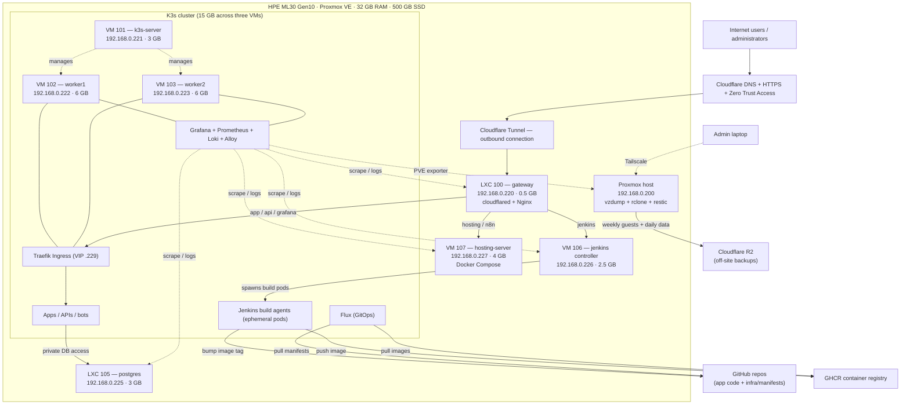

# HPE ProLiant ML30 Gen10 — Final Proxmox DevOps Homelab Plan (v2)

**Status:** Proposed architecture / implementation reference  
**Date:** 2026-11-17 (revised from 2026-11-08 plan)  
**Goal:** Run a DevOps homelab with K3s, dedicated hosting, Jenkins CI, GitOps CD, PostgreSQL, Cloudflare Tunnel, and centralized monitoring **within 32 GB RAM and a single 500 GB SSD**.

> [!IMPORTANT]
> This is designed for learning, development, and **light production-like workloads**, not for high availability or heavy simultaneous builds. Everything runs on **one physical server**. Confirm current VM IDs, IP availability, and Proxmox storage capacity before provisioning.

> [!TIP]
> New to a tool in this plan? Each technology has a beginner guide in [`docs/`](docs/README.md) — start with [`docs/00-overview`](docs/00-overview/README.md).

### What changed from v1

| Area | v1 | v2 | Why |
|---|---|---|---|
| Proxmox install | Default disk layout | `maxroot=30`, `swapsize=4`, `minfree=16` | Default layout leaves only ~340 GiB for VM disks — v1's 350 GB did not fit |
| Storage backend | Unspecified | **LVM-thin** + `discard=on`, `ssd=1` | ZFS ARC competes for RAM on a 32 GB single-disk host |
| Gateway | VM, 1 GB | **LXC, 512 MB** | Nginx + cloudflared don't need a full VM |
| PostgreSQL | VM, 3 GB | **LXC, 3 GB** | Lower overhead, near-native I/O |
| K3s workers | 3 × 4 GB | **2 × 6 GB** | Less duplicated OS/agent overhead; ~5 GB usable per node instead of ~3 GB |
| Jenkins builds | On the Jenkins VM | **Ephemeral K3s pod agents** (rootless BuildKit) | Builds get pod limits instead of starving the host |
| Deploys | Jenkins → kubectl | **Jenkins = CI, Flux = CD (GitOps)** | Git is the source of truth; no cluster-admin creds in Jenkins |
| Registry | Unspecified | **GHCR** (or `registry:2` on hosting VM) | Was a missing piece |
| Provisioning | Manual | **OpenTofu + Ansible** | Reproducible rebuilds |
| Secrets | Unspecified | **SOPS + age** | Safe secrets in Git |
| Backups | "Off-server" | **restic (daily data) + vzdump (weekly guests) → Cloudflare R2** | No extra disk needed; rebuild the rest from Git |
| Remote admin | Unspecified | **Tailscale** + iLO 5 | Never expose Proxmox/SSH publicly |

## 1. Physical hardware

| Component | Specification |
|---|---|
| Server | HPE ProLiant ML30 Gen10 4LFF Hot-Plug CTO |
| CPU | Intel Xeon E-2224, **4 physical cores / 4 threads** |
| Memory | **32 GB RAM** (platform max 64 GB ECC UDIMM, 4 slots) |
| Drive | **500 GB SSD** (Proxmox + all guests) — the only disk |
| Backup target | **Off-site object storage (Cloudflare R2)** — no local backup disk |
| Out-of-band | **iLO 5** (private management network only) |
| Hypervisor | Proxmox VE |
| Guests | **5 VMs + 2 LXC containers** |
| Cluster | K3s: **1 control-plane server + 2 agents (workers)** |
| External access | **Cloudflare Tunnel → Nginx gateway** |
| Monitoring | **Grafana + Prometheus + Loki + Alloy**, hosted as **K3s workloads** |

### Capacity targets

| Resource | Allocated to guests | Nominal remainder | Notes |
|---|---:|---:|---|
| RAM | **25 GB** | **~7 GB** | For Proxmox, page cache, KSM, and overhead. |
| vCPU | **15 vCPUs** | **4 physical cores** | ~3.75:1 overcommit. Fine at light load; CPU contention slows things, it doesn't crash the host. |
| Disk | **278 GB guests + 50 GB backup staging = 328 GB** | **~70 GB of ~400 GiB thin pool** | Headroom for snapshots and growth. Verify with `pvesm status`. |

## 2. Proxmox host setup

### Install-time disk layout (500 GB SSD, ext4/LVM)

In the installer's **Advanced Options** for the target disk:

| Option | Value | Effect |
|---|---|---|
| `hdsize` | (full disk) | |
| `swapsize` | `4` | 4 GiB host swap |
| `maxroot` | `30` | 30 GiB for Proxmox OS, ISOs, templates |
| `minfree` | `16` | Free space left in the VG for LVM snapshots |
| `maxvz` | (leave empty) | Rest → `local-lvm` thin pool (≈ 400 GiB) |

**Storage backend:** **LVM-thin** for guest disks. If ZFS is used anyway, cap ARC (`options zfs zfs_arc_max=2147483648` in `/etc/modprobe.d/zfs.conf`).

### Host tuning

- Every virtual disk: `discard=on`, `ssd=1`, VirtIO SCSI single, `iothread=1`. Enable `fstrim.timer` inside guests.
- VM CPU type: **`host`** (single node, no live migration concern).
- Leave **KSM** enabled — identical Ubuntu guests share memory pages.
- Install `qemu-guest-agent` in every VM.
- Do not overcommit RAM; disable ballooning on K3s nodes (Kubernetes needs predictable memory).
- Startup order: `postgres (1) → k3s-server (2) → workers (3) → jenkins/hosting/gateway (4)`, with 30–60 s delays.
- Configure **iLO 5** for remote console/power; keep it on the private LAN.

### Backup staging area

A 50 GB thin volume holds weekly `vzdump` files only until they are uploaded to R2 (see §14). It is on the same SSD, so it is **not** a backup by itself.

```bash
lvcreate -V 50G -T pve/data -n backup-staging
mkfs.ext4 /dev/pve/backup-staging
mkdir -p /mnt/backup-staging
echo '/dev/pve/backup-staging /mnt/backup-staging ext4 defaults,discard 0 2' >> /etc/fstab
mount -a
pvesm add dir backup-staging --path /mnt/backup-staging --content backup --is_mountpoint yes
```

### Thin-pool safety

Thin provisioning lets virtual disks exceed physical space. **A full thin pool can corrupt every guest at once.** Keep total allocated disk below the pool size and alert at 80%.

```bash
lvs -o lv_name,data_percent,metadata_percent pve
```

---

## 3. Network plan

| Setting | Planned value |
|---|---|
| Proxmox management | `192.168.0.200` (verify actual address) |
| iLO 5 | `192.168.0.210` (private only) |
| Router / default gateway | `192.168.0.1` |
| LAN subnet | `192.168.0.0/24` |
| Linux bridge | `vmbr0` |
| Guest IPs | `192.168.0.220` – `192.168.0.227` |
| K3s ingress VIP (optional, kube-vip) | `192.168.0.229` |
| Primary domain | `sopanha.digital` |
| Guest OS | Ubuntu Server 24.04 LTS (VMs) / Ubuntu 24.04 LXC template |
| Authentication | SSH public keys only |
| Remote admin | **Tailscale** on Proxmox host (subnet router) — not public ports |

**Before deployment:** Ensure `.220`–`.229` are unused and excluded from the DHCP pool. IDs 100–107 might conflict with an earlier homelab; **never overwrite or destroy existing guests**. Use free IDs if necessary.

## 4. Final guest allocation

| ID | Hostname | Type | Role | vCPU | RAM | Disk | Static IP |
|---:|---|---|---|---:|---:|---:|---|
| 100 | `gateway` | **LXC** (unprivileged) | Nginx reverse proxy + `cloudflared` | 1 | **0.5 GB** | 8 GB | `192.168.0.220` |
| 101 | `k3s-server` | VM | K3s control plane (tainted, no app pods) | 2 | **3 GB** | 30 GB | `192.168.0.221` |
| 102 | `k3s-worker1` | VM | K3s agent + apps + monitoring + CI agents | 3 | **6 GB** | 60 GB | `192.168.0.222` |
| 103 | `k3s-worker2` | VM | K3s agent + apps + monitoring + CI agents | 3 | **6 GB** | 60 GB | `192.168.0.223` |
| 104 | — | — | *Reserved (future worker when RAM → 64 GB)* | — | — | — | `192.168.0.224` |
| 105 | `postgres` | **LXC** (unprivileged) | PostgreSQL, private LAN only | 2 | **3 GB** | 50 GB | `192.168.0.225` |
| 106 | `jenkins` | VM | Jenkins controller only (no local builds) | 2 | **2.5 GB** | 30 GB | `192.168.0.226` |
| 107 | `hosting-server` | VM | Ubuntu + Docker/Compose for independent apps | 2 | **4 GB** | 40 GB | `192.168.0.227` |
| **TOTAL** | | **5 VMs + 2 LXC** | | **15** | **25 GB** | **278 GB** | |

**Why 2 workers instead of 3:** all workers share one physical host, so a third worker adds no real redundancy — only another copy of Ubuntu, kubelet, flannel, Alloy, and node-exporter (~0.7–1 GB). Two 6 GB workers give each node room for Prometheus/Loki without evicting apps. VM 104 is reserved to add a third worker after a RAM upgrade.

**Why no monitoring VM:** Grafana, Prometheus, and Loki run in K3s within the worker allocations. VM 107 stays a **dedicated hosting server**.

## 5. End-to-end infrastructure diagram



**Web request flow:** `Client → Cloudflare → cloudflared (LXC 100) → Nginx → (Traefik VIP OR Jenkins OR Hosting VM)`.

**Delivery flow:** `git push → Jenkins → build pod (BuildKit) → GHCR → commit new tag to manifests repo → Flux reconciles → K3s`.

## 6. Cloudflare and Nginx design

- Use a **dedicated Cloudflare Tunnel** for this gateway so an existing tunnel isn't broken.
- Run `cloudflared` and Nginx in **LXC 100**; Nginx listens on **`127.0.0.1:80`** for tunnel traffic.
- Publish each hostname through the tunnel to `http://127.0.0.1:80`; Nginx routes by **Host** header.
- Do **not** forward router ports to Proxmox or any guest.

> **Alternative (fewer moving parts):** `cloudflared` can route hostnames directly to Traefik/Jenkins/hosting without Nginx. Run it as a 2-replica Deployment in K3s and drop LXC 100. Keep Nginx only if learning it is a goal.

| DNS hostname | Nginx target | Security policy |
|---|---|---|
| `app.sopanha.digital` | Traefik VIP `192.168.0.229:80` | Public or app-specific auth |
| `api.sopanha.digital` | Traefik VIP `192.168.0.229:80` | API auth + rate limiting |
| `grafana.sopanha.digital` | Traefik → Grafana Service | **Cloudflare Access** + Grafana login |
| `jenkins.sopanha.digital` | `192.168.0.226:8080` | **Cloudflare Access** + Jenkins login |
| `hosting.sopanha.digital` | `192.168.0.227:80` | Based on app sensitivity |
| `n8n.sopanha.digital` | Hosting VM → n8n (optional) | **Cloudflare Access** if private |

**Never publish** PostgreSQL `:5432`, the K3s API `:6443`, Proxmox `:8006`, iLO, or unprotected Prometheus/Loki endpoints.

### Nginx routing example (outline)

```nginx
# Use the kube-vip VIP once configured; until then list worker IPs.
upstream k3s_ingress {
    server 192.168.0.229:80;
    # server 192.168.0.222:80;
    # server 192.168.0.223:80;
}

map $http_upgrade $connection_upgrade {
    default upgrade;
    ''      close;
}

server {
    listen 127.0.0.1:80;
    server_name app.sopanha.digital api.sopanha.digital grafana.sopanha.digital;
    location / {
        proxy_pass http://k3s_ingress;
        proxy_http_version 1.1;
        proxy_set_header Host $host;
        proxy_set_header X-Forwarded-Proto https;
        proxy_set_header X-Forwarded-For $proxy_add_x_forwarded_for;
        proxy_set_header Upgrade $http_upgrade;
        proxy_set_header Connection $connection_upgrade;
    }
}

server {
    listen 127.0.0.1:80;
    server_name jenkins.sopanha.digital;
    location / {
        proxy_pass http://192.168.0.226:8080;
        proxy_http_version 1.1;
        proxy_set_header Host $host;
        proxy_set_header X-Forwarded-Proto https;
        proxy_set_header X-Forwarded-For $proxy_add_x_forwarded_for;
        proxy_set_header Upgrade $http_upgrade;
        proxy_set_header Connection $connection_upgrade;
    }
}

server {
    listen 127.0.0.1:80;
    server_name hosting.sopanha.digital;
    location / {
        proxy_pass http://192.168.0.227:80;
        proxy_set_header Host $host;
        proxy_set_header X-Forwarded-Proto https;
    }
}

server {
    listen 127.0.0.1:80 default_server;
    return 404;
}
```

A Host header alone is not access control — configure app-side proxy trust and authentication.

## 7. K3s cluster design

- **Control plane (VM 101):** K3s server with embedded SQLite; taint it `node-role.kubernetes.io/control-plane:NoSchedule` so apps land on workers.
- **Workers (VMs 102–103):** Apps, monitoring, Flux, and Jenkins build pods.
- **Ingress:** Traefik (bundled). Expose it on a single **kube-vip** VIP (`192.168.0.229`) so the gateway has one target; disable K3s `servicelb` if using kube-vip for LoadBalancer services.
- **Storage:** `local-path` PVs are **node-local**. Pin stateful monitoring (Prometheus, Loki) with node affinity so pods don't lose their data on reschedule. Do **not** install Longhorn on this hardware — too heavy for a single disk.
- **GitOps:** **Flux** (~200 MB) reconciles a `homelab-infra` repo. ArgoCD is an alternative if a UI is wanted (~1 GB).
- **Secrets:** **SOPS + age**, decrypted by Flux at apply time. Never commit plaintext secrets.
- **Hygiene:** namespaces, requests/limits on every pod, readiness/liveness probes, `LimitRange` defaults per namespace.

### Resource discipline

Each worker has **6 GB total**; ~1–1.2 GB goes to Ubuntu, kubelet, containerd, flannel, and system pods, leaving **~4.8–5 GB for workloads**.

| Component | Memory request | Memory limit | Notes |
|---|---:|---:|---|
| Prometheus | 768 MiB | 1,536 MiB | 15-day retention, 30 s scrape. Swap for **VictoriaMetrics single** (3–5× less RAM/disk) if tight. |
| Loki (single binary) | 256 MiB | 768 MiB | 7-day retention via compactor. |
| Grafana | 128 MiB | 512 MiB | |
| Alloy (DaemonSet) | 64 MiB/node | 256 MiB/node | |
| kube-state-metrics | 64 MiB | 128 MiB | |
| Flux controllers | 128 MiB | 512 MiB | Combined. |
| Jenkins build pod | 1 GiB | 2 GiB | **One concurrent build** to start. |

Set a lower `PriorityClass` for monitoring and build pods than for apps, so pressure evicts those first.

## 8. Monitoring and centralized logs

Monitoring runs **in K3s**; there is no monitoring VM.

| Component | Where | Purpose |
|---|---|---|
| Grafana | K3s Deployment | Dashboards, exploration, alerting |
| Prometheus (or VictoriaMetrics) | K3s StatefulSet, pinned node | Metrics storage |
| Loki | K3s, pinned node, PV | Log storage |
| Grafana Alloy | K3s DaemonSet + systemd agent on VMs/LXCs | Logs and host telemetry |
| Node Exporter | All VMs; Proxmox host | CPU, memory, disk, network |
| kube-state-metrics | K3s | Workload state |
| PVE exporter | K3s pod → Proxmox API (read-only token) | Host / guest metrics, **thin-pool usage** |
| PostgreSQL exporter | LXC 105 | DB health |
| Jenkins Prometheus plugin | VM 106 | Jobs, queue, executors |

### Dashboards

1. **Proxmox overview:** host CPU, memory, **thin-pool data/metadata %**, guest uptime.
2. **Guests:** CPU/memory/disk/network for all seven guests.
3. **K3s:** node Ready, pod resources, restarts, pending pods, Flux reconciliation status.
4. **Web apps:** request rate, 4xx/5xx, latency (when instrumented).
5. **CI/CD:** Jenkins job duration, queue, failures; Flux sync failures.
6. **PostgreSQL:** connections, locks, cache hit rate, size growth.
7. **Logs:** pod stdout/stderr, Nginx, Jenkins, PostgreSQL, system logs.

### Retention

| Data | Policy |
|---|---|
| Metrics | **15 days**, 30 s scrape |
| Logs | **7 days** (compactor-enforced) |
| Debug logs | Only when needed |

### Alerts

- Host CPU > 85–90% for 10 min; host memory low / swap rising.
- **Thin pool data or metadata > 80%.**
- Any PV or guest disk > 80–85%.
- K3s node NotReady; crash-looping pods; Flux reconciliation failing.
- Jenkins queue growing / repeated failures.
- PostgreSQL down or connection saturation.
- Nginx 5xx rate high; monitoring targets down.
- Backup job (restic or vzdump upload) failed or not run on schedule.

Monitoring shares the host, so a **host outage silences alerts**. Add an **external uptime check** (e.g., Cloudflare Health Checks, UptimeRobot, Healthchecks.io) for public endpoints and a backup heartbeat.

## 9. Dedicated hosting server (VM 107)

- IP `192.168.0.227`, **2 vCPU / 4 GB / 40 GB**
- Ubuntu Server, Docker Engine, Docker Compose, optional local reverse proxy (Caddy/Traefik)
- Workloads: n8n, bots, dev websites, small self-hosted apps
- Optional: lightweight `registry:2` if a private local registry is preferred over GHCR
- Public only via Cloudflare Tunnel → gateway when explicitly allowed
- Compose files kept in Git and deployed via Ansible or a Jenkins job

## 10. CI/CD pipeline

**Jenkins = CI (build/test/publish). Flux = CD (deploy).**

```text
git push (app repo)
  → GitHub webhook → Jenkins controller (VM 106)
  → Kubernetes plugin spawns ephemeral build pod on a worker
      → unit tests
      → build image with rootless BuildKit (Kaniko is archived — don't use it)
      → push to ghcr.io/<user>/<app>:<git-sha>
      → commit new image tag to homelab-infra repo
  → Flux detects change → applies to K3s
  → readiness check; rollback = git revert
  → Grafana metrics + Loki logs
```

Safeguards:

- **One concurrent build** initially; build pods have explicit CPU/memory limits.
- Jenkins controller runs **0 executors** — no builds on VM 106.
- Jenkins holds **no cluster-admin kubeconfig**: only a namespaced ServiceAccount allowed to create pods in `ci`, plus a GitHub deploy key for the infra repo.
- Registry/GitHub tokens in Jenkins Credentials; never in Jenkinsfiles.
- Jenkins behind Cloudflare Access **and** Jenkins auth.

## 11. Database (LXC 105)

- Unprivileged LXC, Ubuntu 24.04, PostgreSQL 16+
- IP `192.168.0.225`, port `5432` **private**
- `pg_hba.conf` allows only K3s worker IPs (pod traffic is SNAT'd to node IPs by flannel) and Jenkins if needed
- Per-app roles/databases, strong passwords, TLS for sensitive data
- Nightly `pg_dump`, uploaded off-site by restic (§14); test restores
- Proxmox firewall on the container: allow 5432 only from `.222`, `.223`

## 12. Infrastructure as code

All guests and configuration live in a `homelab-infra` Git repo:

| Layer | Tool | What it manages |
|---|---|---|
| Guests | **OpenTofu/Terraform** + `bpg/proxmox` provider | VMs, LXCs, disks, cloud-init, IPs |
| OS config | **Ansible** | Packages, users/SSH keys, Docker, Nginx, cloudflared, PostgreSQL, Jenkins, Alloy, node-exporter, K3s install |
| Cluster | **Flux** | Traefik config, monitoring stack, apps |
| Secrets | **SOPS + age** | Encrypted values in Git |

Goal: any guest can be destroyed and rebuilt from Git + backups.

## 13. Security and isolation

1. Cloudflare Tunnel only; **no router port forwarding**.
2. **Cloudflare Access** in front of Jenkins, Grafana, n8n, and any admin UI.
3. **Tailscale** (subnet router on the Proxmox host) for SSH, Proxmox UI, and iLO access from outside.
4. Proxmox UI, iLO, K3s API, PostgreSQL, Prometheus, Loki stay private.
5. SSH keys only; disable password auth and root SSH on guests.
6. **Proxmox firewall** enabled at datacenter level; per-guest rules (DB only from workers, `6443` only from LAN admin + workers, flannel UDP `8472` only between K3s nodes).
7. Unprivileged LXCs for gateway and PostgreSQL.
8. Protect K3s join token, tunnel credentials, age key, DB and Jenkins secrets (age private key backed up offline).
9. Regular updates: `unattended-upgrades` on guests; scheduled Proxmox, K3s, Jenkins, Grafana updates.
10. Validate Cloudflare Access JWT at origin where supported.

## 14. Backups

There is **no local backup disk**. The strategy is: **rebuild machines from Git (IaC), restore data from off-site.**

| What | Tool | Destination | Schedule | Retention |
|---|---|---|---|---|
| **Data** — PostgreSQL dumps, Jenkins home, hosting Docker volumes, Grafana DB | **restic** (encrypted, deduplicated) | **Cloudflare R2** bucket | Daily | 7 daily, 4 weekly, 6 monthly |
| **Whole guests** — 101 (K3s datastore), 105, 106, 107 | **vzdump** (zstd, snapshot mode) → 50 GB staging → **rclone** | Cloudflare R2 bucket | Weekly | 1 local (staging), 4 in R2 |
| Workers 102/103, gateway 100 | Not backed up | — | — | Rebuilt from OpenTofu + Ansible + Flux |
| Infra config | Git | GitHub | On change | Full history |

- **Cost estimate:** R2 gives 10 GB free, then about **US$0.015 per GB-month** with no download (egress) fees. 50–150 GB ≈ **US$1–2/month**. Backblaze B2 is a similar alternative.
- **Upload speed matters:** the first weekly vzdump upload may take hours on a home connection; schedule it at night.
- **restic password and R2 keys** must also be stored **outside** the server (password manager), or the backups are useless.
- Test a DB restore and a full guest restore (download from R2 → `qmrestore`/`pct restore`) at least once.
- Without a local backup disk, a restore needs a download first — expect slower recovery.

## 15. Stability and failure planning

| Situation | Likely result | Action |
|---|---|---|
| Normal low traffic | Responsive | Monitor CPU/latency |
| Jenkins build running | Workers slower | 1 concurrent build; pod CPU limits |
| Sustained 100% CPU | Timeouts, probe failures | Reduce load; check which guest |
| Memory exhaustion | OOM kills of pods/guests | Limits, PriorityClasses, host memory alert |
| **Thin pool full** | **All guests I/O-error, possible corruption** | Alert at 80%; keep allocations < pool size |
| SSD failure | All guests down | Replace SSD, reinstall Proxmox, rebuild from Git, restore data from R2 |
| Whole server lost | Everything down | Rebuild from Git (IaC) + off-site backups |

## 16. Deployment phases and acceptance checks

### Phase 0 — Host

- [ ] Update BIOS/iLO firmware; configure iLO on private LAN.
- [ ] Verify CPU, 32 GB RAM, SSD SMART health.
- [ ] Install Proxmox with `maxroot=30`, `swapsize=4`, `minfree=16`; confirm `local-lvm` ≈ 400 GiB.
- [ ] Configure no-subscription repo, updates, Proxmox firewall, Tailscale.
- [ ] Create the 50 GB `backup-staging` storage; create an R2 bucket and API token.
- [ ] Confirm free guest IDs and `.220`–`.229` IPs.

### Phase 1 — IaC and guests

- [ ] Create `homelab-infra` repo (OpenTofu + Ansible + Flux + SOPS layout).
- [ ] Build an Ubuntu 24.04 cloud-init VM template; download Ubuntu LXC template.
- [ ] Provision 5 VMs + 2 LXCs from OpenTofu with Section 4 sizes, `discard=on`, CPU `host`.
- [ ] Ansible baseline: SSH keys, guest agent, `unattended-upgrades`, node-exporter, Alloy, `fstrim.timer`.

### Phase 2 — K3s

- [ ] Install K3s server on VM 101 (taint control plane).
- [ ] Join workers 102, 103; confirm 3 `Ready` nodes.
- [ ] Install kube-vip for VIP `192.168.0.229`; verify Traefik on the VIP.
- [ ] Bootstrap Flux against `homelab-infra`; configure SOPS decryption.
- [ ] Deploy a test app via Git commit only.

### Phase 3 — Supporting services

- [ ] PostgreSQL in LXC 105; firewall rules; nightly dumps.
- [ ] Jenkins controller on VM 106 (0 executors); Kubernetes plugin → `ci` namespace.
- [ ] Docker/Compose on VM 107; deploy a test page.

### Phase 4 — Gateway and public access

- [ ] Nginx + cloudflared in LXC 100.
- [ ] Dedicated tunnel and hostname routes.
- [ ] Cloudflare Access on Jenkins, Grafana, n8n **before** going public.
- [ ] Test `app`, `api`, `jenkins`, `grafana`, `hosting`.

### Phase 5 — Monitoring

- [ ] Deploy Grafana, Prometheus (or VictoriaMetrics), Loki, Alloy via Flux.
- [ ] PVE exporter (read-only API token), PostgreSQL exporter, Jenkins plugin.
- [ ] Pin Prometheus/Loki PVs; set retention; set PriorityClasses.
- [ ] Alerts from Section 8, including thin-pool usage; external uptime check.

### Phase 6 — CI/CD end-to-end

- [ ] Webhook → Jenkins → build pod → GHCR → infra repo tag bump → Flux deploy.
- [ ] Observe host CPU and app latency during a build.
- [ ] Rollback via `git revert` works.

### Phase 7 — Operations readiness

- [ ] Daily restic and weekly vzdump → R2 jobs green; secrets saved in a password manager.
- [ ] Test restore: one VM, one LXC, one database.
- [ ] Test rebuild: destroy and recreate a worker from IaC.
- [ ] Revoke a Cloudflare Access session and confirm lockout.
- [ ] Document IDs, IPs, restore steps, update procedure.

## 17. Quick verification commands

**Proxmox host:**

```bash
qm list && pct list
pvesm status
lvs -o lv_name,data_percent,metadata_percent pve
free -h && uptime
```

**K3s server:**

```bash
sudo k3s kubectl get nodes -o wide
sudo k3s kubectl get pods -A
sudo k3s kubectl top nodes
flux get kustomizations -A
```

**Gateway (LXC 100):**

```bash
sudo nginx -t
sudo systemctl status nginx cloudflared
curl -I -H 'Host: app.sopanha.digital' http://127.0.0.1/
```

**From a trusted client:**

```bash
curl -I https://app.sopanha.digital
curl -I https://hosting.sopanha.digital
```

Jenkins and Grafana should redirect to Cloudflare Access before authentication.

## 18. Final decision and upgrade path

**Approved target layout:**

- **5 VMs + 2 LXCs**, **25 GB RAM**, **15 vCPUs**, **278 GB guest disk + 50 GB backup staging**.
- **~7 GB host RAM headroom**, **~70 GB thin-pool headroom**.
- K3s **1 server + 2 workers (6 GB each)**; monitoring and CI agents in-cluster.
- **Jenkins CI + Flux GitOps**, images in **GHCR**.
- **Cloudflare Tunnel → Nginx (LXC) → K3s / Jenkins / hosting**.
- Everything defined in **OpenTofu + Ansible + Flux**; backups **off-site to Cloudflare R2** (restic + vzdump).

**Upgrade order:**

1. **RAM → 64 GB** (4 × 16 GB ECC UDIMM) — cheapest, biggest gain; then add `k3s-worker3` (VM 104) and raise worker RAM.
2. **Second disk** — a local backup disk (faster restores) or a second SSD for guest data / mirroring.
3. **CPU** (e.g., Xeon E-2236/E-2246G, 6C/12T — verify ML30 Gen10 compatibility and BIOS) only if sustained CPU contention becomes normal.

---

## 19. Official reference documentation

- Proxmox VE: <https://pve.proxmox.com/pve-docs/>
- restic: <https://restic.readthedocs.io/> · rclone: <https://rclone.org/docs/> · Cloudflare R2: <https://developers.cloudflare.com/r2/>
- K3s: <https://docs.k3s.io/>
- kube-vip: <https://kube-vip.io/docs/>
- Flux: <https://fluxcd.io/flux/>
- SOPS: <https://github.com/getsops/sops>
- OpenTofu: <https://opentofu.org/docs/> · bpg/proxmox provider: <https://registry.terraform.io/providers/bpg/proxmox/latest/docs>
- Ansible: <https://docs.ansible.com/>
- Grafana: <https://grafana.com/docs/grafana/latest/>
- Prometheus: <https://prometheus.io/docs/> · VictoriaMetrics: <https://docs.victoriametrics.com/>
- Grafana Loki: <https://grafana.com/docs/loki/latest/>
- Grafana Alloy: <https://grafana.com/docs/alloy/latest/>
- Jenkins Kubernetes plugin: <https://plugins.jenkins.io/kubernetes/>
- Cloudflare Tunnel: <https://developers.cloudflare.com/cloudflare-one/connections/connect-networks/>
- Cloudflare Access: <https://developers.cloudflare.com/cloudflare-one/access-controls/>
- Tailscale subnet routers: <https://tailscale.com/kb/1019/subnets>

*This document is the planned architecture for the specified hardware, not a claim that any guest or service has already been deployed.*
